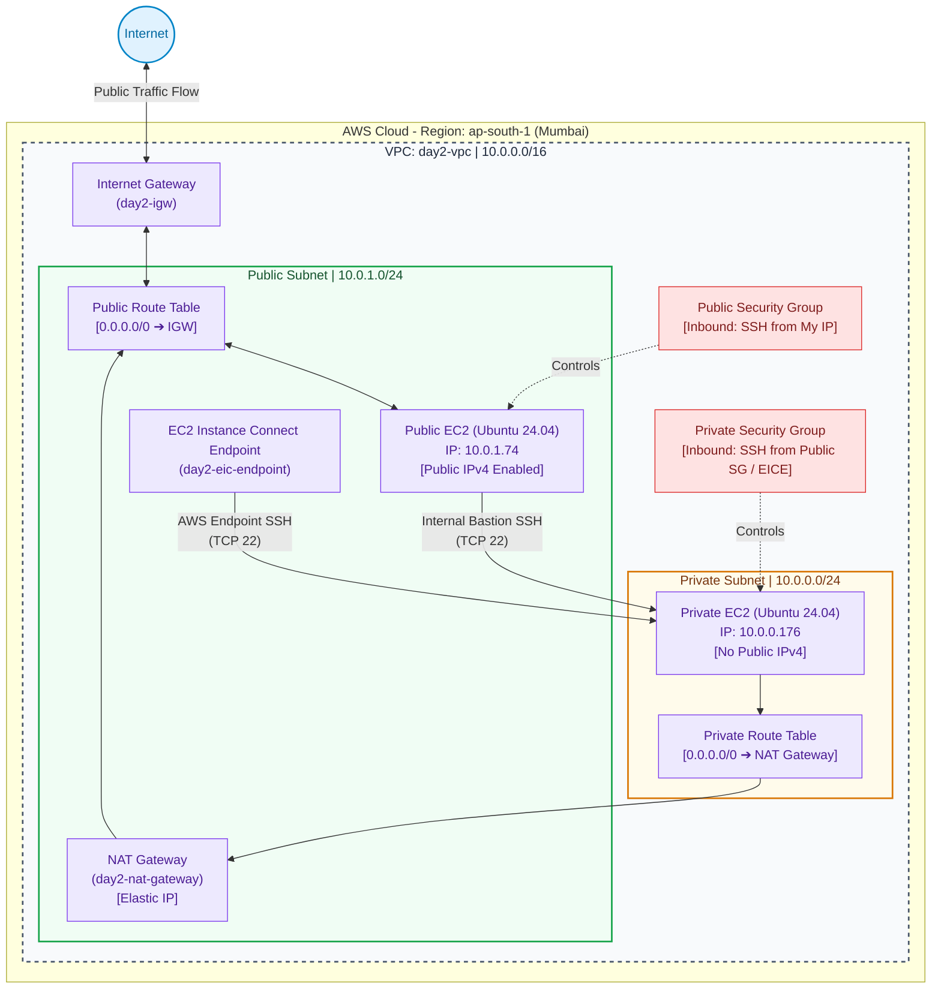

# AWS VPC Networking Architecture (Day 2 Lab Summary)

This repository contains the practical configuration summary and architectural blueprint for building a complete Amazon Web Services (AWS) Custom VPC network framework from the ground up using the AWS Management Console.

The goal of this lab was to map and validate inbound/outbound communication flows between public and private EC2 instances, the internet, and internal services.

---

## 🏗️ Architecture Diagram



---

## 🛠️ Infrastructure Component Details

| Infrastructure Component | Resource Name / Setting | Designated Scope / Mapping Values | Core Architectural Purpose |
| :--- | :--- | :--- | :--- |
| **Virtual Private Cloud (VPC)** | `day2-vpc` | `10.0.0.0/16` | Logically isolated overlay network inside the Mumbai (`ap-south-1`) region. |
| **Public Subnet** | `day2-public-subnet` | `10.0.1.0/24` (Planned) | Houses DMZ resources needing direct exposure (Public IP Auto-Assign: Enabled). |
| **Private Subnet** | `day2-private-subnet` | `10.0.0.0/24` (Actual) | Segregates protected back-end compute engines (Public IP Auto-Assign: Disabled). |
| **Internet Gateway (IGW)** | `day2-igw` | Attached to `day2-vpc` | Provides bi-directional edge routing mapping for public subnet targets. |
| **NAT Gateway** | `day2-nat-gateway` | Public type + Elastic IP | Translates and routes secure outbound requests from private resources to the internet. |
| **EC2 Instance Connect Endpoint** | `day2-eic-endpoint` | Provisioned in Public Subnet | Permits secure IAM-governed private console tunnel connections to the private host. |
| **Public Route Table** | Built-in / Modified | `0.0.0.0/0 ➔ day2-igw` | Explicitly translates target subnet zone properties into a fully functional public network. |
| **Private Route Table** | Custom Created | `0.0.0.0/0 ➔ day2-nat-gateway` | Forwards external non-local traffic securely through the NAT Gateway pipeline. |
| **Public Security Group** | `day2-public-sg` | Inbound: SSH (TCP/22) from My IP | Stateful instance-level firewall safeguarding perimeter compute targets. |
| **Private Security Group** | `day2-private-sg` | Inbound: SSH from `day2-public-sg` | Pin-holes remote terminal ingestion exclusively to trusted internal sources. |

---

## 🖥️ Workload Deployments

*   **Public Host (`day2-public-ec2`):** `t3.micro` | Ubuntu 24.04 LTS | Private IP: `10.0.1.74` | Public Route Enabled.
*   **Private Host (`day2-privatesrvr`):** `t3.micro` | Ubuntu 24.04 LTS | Private IP: `10.0.0.176` | Private LAN Isolated.

*Note: Access to instances was achieved using secure keys managed natively via AWS-managed connection methods rather than relying on standard static local `.pem` files.*

---

## 🧪 Network Connectivity & Validation Log

### Test 1: Public Web Verification
*   **Action:** Ping test executed directly from the public instance shell environment.
    ```bash
    ping -c 4 google.com
    ```
*   **Outcome:** `Successful` — Verifies flawless execution of the Internet Gateway route entry rules.

### Test 2: Outbound Private Web Tunneling via NAT Gateway
*   **Action:** Header query evaluation routed through the isolated instance infrastructure.
    ```bash
    curl -I https://google.com
    ```
*   **Outcome:** `HTTP/2 301` — `Successful` execution verifying functional out-of-band proxy handling through the NAT Gateway pipeline.

### Test 3: Public IP Address Mapping Translation
*   **Action:** Public check query executed concurrently across both deployed hosts.
    ```bash
    curl https://amazonaws.com
    ```
*   **Outcome:** Identical IP output matches across both runs, validating that the private layer leverages the Elastic IP configured on the NAT instance gateway.

### Test 4: LAN Transit Boundary Validation
*   **Action:** Internal network handshake validation run from public node to private node.
    ```bash
    nc -vz 10.0.0.176 22
    ```
*   **Outcome:** `Connection to 10.0.0.176 22 port [tcp/ssh] succeeded!`

---

## 🎓 Core Theoretical Takeaways

*   **Subnet Demarcation:** The distinction between a public and private subnet is determined entirely by its routing table assignments (`0.0.0.0/0` path mapping) rather than its text label.
*   **NAT vs IGW Paths:** An Internet Gateway allows bi-directional traffic, whereas a NAT Gateway strictly limits traffic to one-way outbound data forwarding.
*   **Secure Access Strategies:** Modern solutions like **EC2 Instance Connect Endpoints (EICE)** remove the need to maintain open bastion servers or configure public IP tracking configurations for standard instance management tasks.

---
